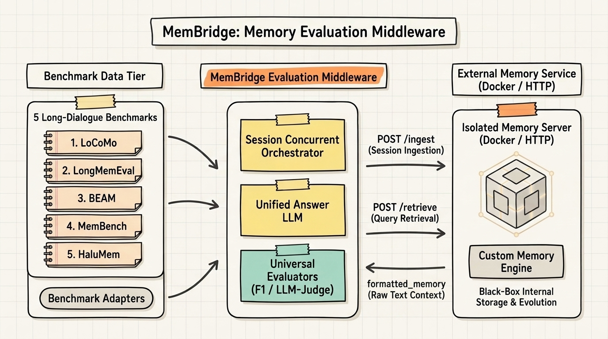
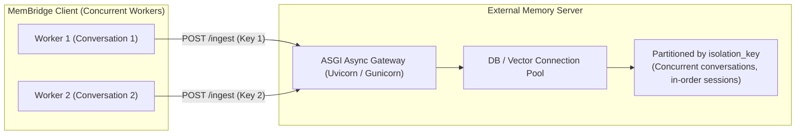

# MemBridge

> **Standardized C/S Evaluation Middleware & Gateway for AI Agent Long-Term Memory Systems**
>
> [English](README.md) | [简体中文](README_zh.md)

MemBridge unifies answer generation and evaluation scoring, requiring the memory system under test only to return raw memories. This isolates and benchmarks memory retention and retrieval quality directly—decoupled from proprietary answering models, custom prompts, or non-standardized scoring metrics across academic literature.

MemBridge and the external memory system operate in a **decoupled Client/Server (C/S) microservice architecture**:
The evaluation client acts as an orchestrator sending benchmark workloads (managing `Ingest` and `Retrieve`, and scoring answers), while the memory system under test runs as an independent HTTP service or Docker container exposing two standardized endpoints (`/ingest` and `/retrieve`).

---

## System Architecture



The system is logically partitioned into three decoupled tiers:

1. **Benchmark & Data Tier**: Supports five major long-dialogue benchmarks: LoCoMo, LongMemEval, BEAM, MemBench, and HaluMem. Raw datasets are parsed through benchmark adapters into unified domain entities (`Conversation`, `Session`, `Turn`, and `Question`) and automatically filtered into a standardized 6-capability taxonomy.
2. **MemBridge Evaluation Middleware**: Operates as the evaluation controller, orchestrating session-level concurrent ingestion and retrieval. Upon retrieval, retrieved memories are safely formatted into standardized prompt templates to generate answers via an Answer LLM, followed by objective and semantic scoring (`ExactMatch`, `F1`, and `LLMJudge`).
3. **Isolated Memory Service (System Under Test)**: Runs as an independent HTTP microservice or Docker container. Treated by MemBridge as a **complete black box** communicating exclusively through `POST /ingest` (session-level writing) and `POST /retrieve` (query-level retrieval). MemBridge makes no assumptions about internal architectures—whether vector databases, knowledge graphs, hierarchical recursive summarization, key-value stores, or hybrid pipelines.

---

## Benchmark Cohort & 6-Capability Taxonomy

Original benchmark questions are standardized by **what a correct answer requires**, converging across all five datasets into 6 core capabilities. Total scores and capability breakdowns evaluate the exact same cohort, automatically filtering unaligned questions during loading.

| Capability | What a Correct Answer Requires | Representative Benchmark Tasks |
| :--- | :--- | :--- |
| **Factual Recall** | Accurately recall previously stated explicit facts | LoCoMo single-hop; LongMemEval user/assistant facts; BEAM fact extraction; MemBench basic identification; HaluMem factual recall |
| **Multi-Hop Synthesis** | Synthesize and reason over multiple disjoint evidence spans | LoCoMo multi-hop; LongMemEval cross-session reasoning; BEAM multi-hop; MemBench comparative filtering; HaluMem multi-hop |
| **Temporal & Ordering** | Answer using precise dates or relative chronological sequence | LoCoMo temporal queries; LongMemEval temporal reasoning; BEAM time intervals and event ordering |
| **Memory Update** | Answer strictly with the latest valid fact after dynamic updates | State and fact update questions across LongMemEval, BEAM, MemBench, and HaluMem |
| **Refusal & Boundary** | Correctly identify unmentioned topics and politely refuse | LongMemEval refusal queries; BEAM refusal rubric; HaluMem memory boundary probes |
| **Personalization** | Strictly adhere to previously established user preferences | LongMemEval preference queries; BEAM preference adherence |

> **Excluded Edge Cases**: Adversarial and open-domain common-sense questions (LoCoMo), unstated implicit emotions and noisy questions (MemBench), internal contradictions and general instruction following (BEAM), premise correction and novel transfer scenarios (HaluMem).

**Unified Evaluation Judge Matrix**:
MemBridge provides three cohesive evaluators: **Exact String Match (`ExactMatch`)**, **Token-Level Overlap (`F1`)**, and a typed Pydantic dual-schema **`LLMJudge`**. When essential context or temporal anchors are missing, the judge automatically outputs `UNDECIDABLE`, routing uncertain cases to manual review to prevent binary hallucination.

---

## Directory Structure & Key Modules

```text
├── configs/
│   └── application.yaml                # Unified configuration (LLM hyperparameters & dynamic prompt matrix)
├── assets/                             # Repository static assets & academic architecture diagram
├── src/memory_benchmark/               # Core middleware source code
│   ├── benchmark_adapters/             # Benchmark loaders & 6-capability cohort filters (LoCoMo, LongMemEval, etc.)
│   ├── core/                           # Domain entities, provider protocol (MemoryProvider), & safe string formatter
│   ├── readers/                        # Unified answer generation (FrameworkAnswerReader injecting memory context)
│   ├── evaluators/                     # Standardized evaluators (ExactMatch, Token F1, dual-mode LLM Judge)
│   ├── runners/                        # Execution runners (concurrent prediction.py & offline evaluation.py)
│   ├── storage/                        # Experiment artifact persistence (atomic JSON Lines I/O)
│   ├── utils/                          # Common utilities (thread-safe run loggers, etc.)
│   └── __main__.py                     # Minimal CLI entrypoints (run, ingest, query, eval)
├── pyproject.toml                      # Project metadata & evaluation dependencies
├── uv.lock                             # Deterministic dependency lockfile
├── .env.example                        # Environment variable template (API_KEY, BASE_URL, MODEL_NAME)
└── .gitignore                          # Strict whitelist filtering rules
```

### Module Responsibilities

- [`configs/application.yaml`](configs/application.yaml): Global benchmark configuration. Configures default parameters for `llm.answer` and `llm.judge`, as well as task-specific system/user prompts across benchmark question types.
- [`src/memory_benchmark/benchmark_adapters/`](src/memory_benchmark/benchmark_adapters/): Unified data interface. Parses raw datasets into `Conversation -> Session -> Turn`, retains only the 6-capability cohort, and strips ground-truth answers from memory ingestion.
- [`src/memory_benchmark/core/`](src/memory_benchmark/core/): Core abstractions. Implements generic `Result[T]` response envelope, minimal two-method client protocol [`HttpMemoryProvider`](src/memory_benchmark/core/provider_protocol.py), and template formatting safe from JSON brace conflicts.
- [`src/memory_benchmark/readers/`](src/memory_benchmark/readers/): Unified answer generation. Injects raw retrieved `formatted_memory` into the configured prompt template and generates answers using the Answer LLM.
- [`src/memory_benchmark/evaluators/`](src/memory_benchmark/evaluators/): Standardized evaluation metrics. Implements string `ExactMatch`, token-level `F1`, and schema-enforced `LLMJudgeEvaluator`.
- [`src/memory_benchmark/runners/`](src/memory_benchmark/runners/): Pipeline orchestrators. Manages multi-threaded concurrent execution partitioned by conversation, deterministically merging outputs by original index.

---

## C/S API Specification & Interface Protocols

The memory server under test (Method Server / Docker container) only needs to expose two standard HTTP POST endpoints, returning standard `Result[T]` JSON envelopes:

### 1. Memory Ingestion (`POST /ingest`)

Delivers memories at the granularity of a **Session** (a single interactive episode containing multiple conversational turns).

- **Request Entity (`IngestRequest`)**:
  - `isolation_key` (`str`, required): Data partition key (`{run_id}_{conversation_id}`). Ensures complete isolation between conversations;
  - `session` (`Session`, required): Current session data payload:
    - `session_id` (`str`): Unique session identifier;
    - `session_time` (`str | null`): Session timestamp anchor (e.g., `"2023-05-10 14:30:00"`);
    - `turns` (`list[Turn]`): List of conversational turns:
      - `turn_id` (`str`): Turn identifier;
      - `speaker` (`str`): Speaker identifier. Supports two conventions:
        1. **Standard roles** (LongMemEval / BEAM / HaluMem / MemBench): `"user"` and `"assistant"` / `"agent"`;
        2. **Named personas** (LoCoMo): Specific characters (e.g., `"Alice"`, `"Bob"`, `"Caroline"`);
        *Recommendation*: Memory systems can directly use `speaker` as entity subjects or source tags.
      - `turn_time` (`str | null`): Specific turn timestamp (when available in BEAM/HaluMem, otherwise `null`);
      - `content` (`str`): Utterance text (multimodal image descriptions are standardized as inline text descriptions);
  - `metadata` (`dict`): Scheduling metadata, such as `{"is_last_session": true}` marking conversation completion.

> **Temporal Fallback Strategy**:
> When constructing timestamped memories, systems should follow hierarchical inheritance: **Prefer `turn.turn_time`; if `null`, automatically inherit the session-level `session.session_time`**. This guarantees a complete chronological chain of evidence across all benchmarks.

**Request JSON Example**:
```json
{
  "isolation_key": "locomo_run1_conv01",
  "session": {
    "session_id": "session_01",
    "session_time": "2023-05-10 14:30:00",
    "turns": [
      {
        "turn_id": "turn_01",
        "speaker": "Alice",
        "turn_time": "2023-05-10 14:30:05",
        "content": "Hi Bob, I just moved to Seattle yesterday!"
      },
      {
        "turn_id": "turn_02",
        "speaker": "Bob",
        "turn_time": "2023-05-10 14:30:20",
        "content": "Welcome to Seattle! How do you like the weather?"
      }
    ]
  },
  "metadata": {
    "is_last_session": false
  }
}
```

- **Response Entity (`Result[None]`)**:
```json
{
  "code": 200,
  "message": "ok",
  "data": null,
  "latency_ms": 15.2
}
```

---

### 2. Memory Retrieval (`POST /retrieve`)

Retrieves relevant memories based on the test query and isolation key. Returns plain text `formatted_memory` without answering the question.

- **Request Entity (`RetrieveRequest`)**:
  - `isolation_key` (`str`, required): Must match the ingestion partition key;
  - `query` (`str`, required): The question text to be answered;
  - `question_time` (`str | null`): Timestamp anchor of the query (assists relative time reasoning);
  - `question_id` (`str | null`): Unique test question identifier;
  - `metadata` (`dict`): Optional retrieval metadata.

**Request JSON Example**:
```json
{
  "isolation_key": "locomo_run1_conv01",
  "query": "Where did Alice move recently?",
  "question_time": "2023-05-15",
  "question_id": "q_01",
  "metadata": {}
}
```

- **Response Entity (`Result[RetrievePayload]`)**:
```json
{
  "code": 200,
  "message": "ok",
  "data": {
    "formatted_memory": "Alice moved to Seattle on 2023-05-10."
  },
  "latency_ms": 8.6
}
```

> **Dual Latency Tracking**:
> - `latency_ms` in the response body is optional, representing internal server computation time;
> - MemBridge continuously measures end-to-end network round-trip time (Wall-Clock Latency) on the client side using high-precision `time.perf_counter()`;
> - If the server includes `latency_ms`, MemBridge records and reports both metrics, enabling clear comparison between server computation and network overhead.

---

## Server-Side Concurrency & Engineering Guidelines

The MemBridge client supports multi-threaded concurrent evaluation via `-w` / `--max-workers` (e.g., `-w 10`). Because client workers concurrently send HTTP requests to the external Memory Server, **the server must implement adequate concurrency controls and data safety guards**:



### 1. In-Order Session Delivery Within Conversations
For a given `isolation_key` (i.e., a single conversation), MemBridge **strictly delivers sessions serially in ascending chronological order**:
- The client only dispatches the next session after receiving a successful `200 OK` response for the previous one;
- Multi-threading (`-w`) **only operates across different conversations**, never within the same conversation, eliminating race conditions or reversed causal timelines.

### 2. Strict Partitioning by `isolation_key`
Concurrent workers schedule independent conversations. Every request sent to the server carries a globally unique `isolation_key` (e.g., `run01_conv_1` and `run01_conv_2`):
- **Server Rule**: Never append memories to global singleton variables. Use `isolation_key` as the partition key, namespace, or collection ID;
- Ensure that concurrent ingest operations for Conversation 1 never leak into Conversation 2.

### 3. Production ASGI Deployment
- Avoid single-process, single-threaded development servers;
- Deploy FastAPI or equivalent frameworks with multi-worker ASGI containers:
  ```bash
  uvicorn server:app --host 0.0.0.0 --port 8002 --workers 4
  ```

### 4. Connection Pool Sizing
- If the server utilizes PostgreSQL, MySQL, Qdrant, or Milvus, ensure the connection pool size (`pool_size` + `max_overflow`) is greater than or equal to the client's `--max-workers`;
- Prevents request timeouts caused by pool exhaustion (`QueuePool limit exceeded`).

### 5. Safe Client Defaults
- **Default Single-Worker Mode**: Omitting `-w` defaults to `--max-workers 1` (serial execution);
- Lightweight, single-threaded, or local file-based memory prototypes run reliably without crashes; scale `-w` only when the server is built for concurrency.

---

## Getting Started

MemBridge and the memory system under test communicate via decoupled HTTP APIs:
The client orchestrates evaluation workloads (Ingest, Retrieve, and Scoring), while the memory system runs as an independent HTTP server.

### 1. Install uv & Initialize Environment

We recommend [uv](https://docs.astral.sh/uv/) for high-speed dependency management:

```bash
# 1. Install uv (if not already installed)
# macOS / Linux:
curl -LsSf https://astral.sh/uv/install.sh | sh
# Or via Homebrew:
# brew install uv

# 2. Sync dependencies into virtual environment
uv sync
```

### 2. Configure Environment Variables

Copy `.env.example` to `.env` to configure LLM parameters for answer generation and evaluation:

```bash
cp .env.example .env
```

Set the required variables in `.env` (compatible with OpenAI `/v1/chat/completions` or any compatible proxy):

```bash
API_KEY=your_api_key_here
BASE_URL=https://api.openai.com/v1
MODEL_NAME=gpt-4o-mini
```

### 3. Run Automated Contract Tests

Verify system integrity and documentation drift contracts before running experiments:

```bash
uv run pytest -q
```

---

### 4. Running Evaluations

#### Option A: One-Click Fast Smoke Test (Verify Connectivity & Serialization in Seconds)

After starting your Memory Server, run the smoke test to verify network routing and entity serialization:

```bash
uv run membridge run --smoke --server-url http://127.0.0.1:8002
```

> **What `--smoke` does**: Constrains execution to "1 conversation, 1 session, 1 question". Triggers exactly 1 `POST /ingest` and 1 `POST /retrieve`, verifying the end-to-end pipeline in seconds without token waste or indexing delays.

#### Option B: Full Production Evaluation (Default Full Dataset)

Specify your server endpoint via `--server-url` (defaults to the full dataset):

```bash
uv run membridge run \
  -b locomo \
  --server-url http://127.0.0.1:8002 \
  --metrics f1
```

#### Option C: Decoupled Multi-Phase Execution (Separate Ingest, Query, and Eval)

When memory ingestion is computationally expensive or when tuning prompts and metrics repeatedly:

```bash
# Phase 1: Ingest dialogue sessions into the memory server (no answering LLM calls)
uv run membridge ingest -b locomo --run-id exp_locomo_01 --server-url http://127.0.0.1:8002

# Phase 2: Retrieve with the same --run-id, so the isolation key matches the ingest
uv run membridge query -b locomo --run-id exp_locomo_01 --server-url http://127.0.0.1:8002

# Phase 3: Evaluate predictions offline (requires --run-dir & --metrics, no server requests)
uv run membridge eval --run-dir outputs/exp_locomo_01 --metrics f1,exact_match
```

---

## CLI Reference

MemBridge employs a **subcommand pipeline architecture**, keeping parameters and phase responsibilities decoupled:

| Subcommand | Core Responsibility | Typical Use Case |
| :--- | :--- | :--- |
| `run` *(default)* | End-to-end evaluation (Ingest $\rightarrow$ Query $\rightarrow$ Evaluate) | Full benchmark runs, smoke testing |
| `ingest` | Phase 1: Ingest long-dialogue session history into Memory Server | Database warmup, offline pre-indexing |
| `query` | Phase 2: Retrieve memories and generate answers | Tuning prompt templates, testing answer models |
| `eval` | Phase 3: Offline metric scoring on saved predictions (requires `--metrics`) | Offline re-evaluation without LLM/server costs |

### 1. Global & Data Options

Applicable to `run`, `ingest`, and `query` subcommands (`membridge [options]` defaults to `run`):

| Option | Short | Default | Choices / Example | Description |
| :--- | :--- | :--- | :--- | :--- |
| `--benchmark` | `-b` | `locomo` | `locomo`, `longmemeval`, `halumem`, `beam`, `membench` | Target benchmark dataset. |
| `--smoke` | - | `False` | Flag | **One-click smoke mode**: Locks to 1 conversation, 1 session, 1 question for instant verification. Defaults to full evaluation when omitted. |
| `--server-url` | `-u` | `http://127.0.0.1:8002` | `http://127.0.0.1:8002` | HTTP base URL of the Memory Server under test. |
| `--max-workers` | `-w` | `1` | Integer (e.g., `4`, `10`) | Number of concurrent conversation workers. Results are merged deterministically in ascending order. |
| `--run-id` | - | Auto-generated unique id | String (e.g., `exp_locomo_01`) | Experiment id. Defaults to `{benchmark}_{method}_{utc-timestamp}_{8 hex}`. Artifacts are saved to `outputs/{run_id}/`. An existing directory is refused unless `--resume` or `--force` is set. |
| `--resume` | - | `False` | Flag | Continue the given `--run-id`, skipping conversations already marked completed in the checkpoint. |
| `--force` | - | `False` | Flag | Overwrite an existing run directory. |
| `--timeout-seconds` | - | `1800` | Positive number | HTTP timeout for ingest and retrieve. The default stays 1800 because one session can take minutes to build. |
| `--project-root` | - | `.` | Path string | Root directory path of the project. |

### 2. Metrics & LLM Options

Applicable to `run` (online evaluation) and `eval` (offline re-scoring):

| Option | Short | Default | Choices / Example | Description |
| :--- | :--- | :--- | :--- | :--- |
| `--metrics` | - | `f1` | `f1`, `exact_match`, `llm_judge` | Comma-separated evaluation metrics (e.g., `--metrics f1,exact_match`). |
| `--mock-llm` | - | `False` | Flag | Uses deterministic local mock client for answers without external API calls. |

### 3. Offline Evaluation Options

Applicable exclusively to the `eval` subcommand:

| Option | Short | Default | Choices / Example | Description |
| :--- | :--- | :--- | :--- | :--- |
| `--run-dir` | - | **Required** | `outputs/locomo_http` | Path to target experiment output directory (containing `method_predictions.jsonl`). |

---

## Cookbook & Common Scenarios

#### Scenario 1: One-Click Quick Smoke Test
```bash
uv run membridge run --smoke --server-url http://127.0.0.1:8002
```

#### Scenario 2: Full Benchmark Run (Default Full Dataset against External Service)
```bash
uv run membridge run \
  -b locomo \
  --server-url http://127.0.0.1:8002 \
  --metrics f1
```

#### Scenario 3: 10-Worker High-Concurrency Acceleration (Recommended for LoCoMo)
```bash
uv run membridge run \
  -b locomo \
  --server-url http://127.0.0.1:8002 \
  -w 10 \
  --metrics f1
```

#### Scenario 4: Multi-Metric Evaluation (F1 + Exact Match)
```bash
uv run membridge run \
  -b locomo \
  --server-url http://127.0.0.1:8002 \
  --smoke \
  --metrics f1,exact_match
```

#### Scenario 5: Offline Re-Evaluation (Zero Token Cost & No Server Ingestion)
```bash
uv run membridge eval \
  --run-dir outputs/locomo_http \
  --metrics exact_match,llm_judge
```
