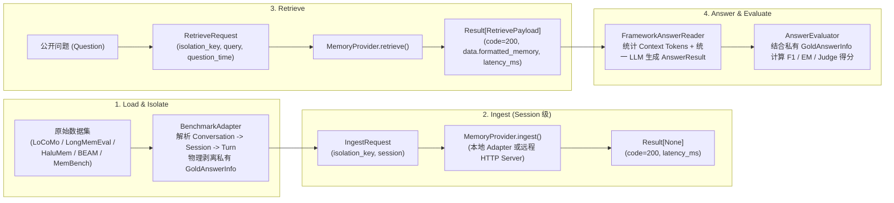
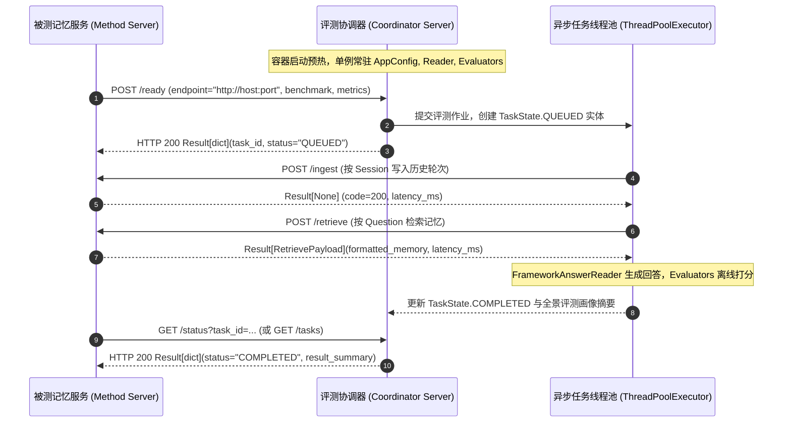

# MemBridge 架构设计说明书 (`docs/architecture.md`)

> **文档定位**：定义 MemBridge 的核心分层、统一 `Result[T]` 响应规范、极简双方法中间层协议（`MemoryProvider`）与端到端评测数据流。

---

## 1. 核心设计哲学：轻量级 C/S 评测中间层

不同开源 Agent Memory 系统（如 Mem0、LightMem、MemoryOS、Letta、Graphiti）运行环境与依赖高度冲突，且内部操作黑盒化。MemBridge 将自身定位为**标准化的评测中间层（Evaluation Middleware）**：

1. **中间层极简双方法契约（Only `ingest` & `retrieve`）**：
   - 废除传统进程内框架繁琐的 6 个生命周期钩子，中间层接口 `MemoryProvider` **仅定义 2 个核心方法**：`ingest`（写入记忆）与 `retrieve`（检索记忆）；
   - 每次调用显式传递 `isolation_key: str`，由被测记忆服务（Method Server / Docker 容器或本地实现）自行管理底层存储命名空间隔离。
2. **统一 `Session` 级写入粒度**：
   - 单次 `ingest` 固定接收一个 `Session`（包含 `session_id`、`session_time` 及 `turns: list[Turn]`）；
   - 既避免了单轮（Turn）高频网络请求的连接开销，又规避了整段长对话（Conversation 往往耗时数十分钟至上百分钟）单次请求导致的 HTTP 超时与失败重跑代价；同时天然保留了会话级时间戳（`session_time`）与会话结束边界。
3. **仿 Spring Boot 的泛型响应封装（`Result[T]`）**：
   - 将网络/执行状态元数据（`code: int`、`message: str`、`latency_ms: float`）与业务载荷（`data: T`）彻底解耦；
   - `code = 200` 代表成功，非 `200` 代表服务异常或超时。
4. **黑盒服务可观测指标（Black-Box Efficiency Metrics）**：
   - 既然被测记忆系统作为独立黑盒服务运行，评测端不侵入其内部统计建库 Token，而是客观测量客户端可观测的 3 项硬核指标：
     1. **记忆构建时间 (`ingest_latency_ms`)**：单次 Session 写入耗时与会话累计构建耗时；
     2. **记忆检索时间**：客户端 `perf_counter()` 墙钟（Mean / P50 / P95），以及服务端自报的 `latency_ms`（有则另记，不覆盖墙钟）；
     3. **检索上下文 Token 长度 (`retrieved_context_tokens`)**：对 `retrieve` 返回的 `formatted_memory` 进行 Token 计数，直接衡量记忆系统输出的上下文精炼度及对下游 Reader LLM 的推理开销。

---

## 2. 四阶段端到端数据流



---

## 3. 核心协议与数据结构 (`src/memory_benchmark/core/provider_protocol.py`)

```python
T = TypeVar("T")

@dataclass(frozen=True)
class Result(Generic[T]):
    """统一服务响应信封（对齐 Spring Boot Result<T> 设计规范）。"""
    code: int = 200
    message: str = "ok"
    data: T | None = None
    latency_ms: float = 0.0

    @property
    def is_success(self) -> bool:
        return self.code == 200


@dataclass(frozen=True)
class IngestRequest:
    """单次记忆写入请求：固定以一个 Session (含 list[Turn]) 为传输单元。"""
    isolation_key: str
    session: Session


@dataclass(frozen=True)
class RetrieveRequest:
    """单次记忆检索请求。"""
    isolation_key: str
    query: str
    question_time: str | None = None
    top_k: int = 10
    question_id: str | None = None
    metadata: dict[str, Any] = field(default_factory=dict)


@dataclass(frozen=True)
class RetrievePayload:
    """检索接口返回的纯业务数据载荷。"""
    formatted_memory: str


class MemoryProvider(ABC):
    """极简双方法记忆评测中间层协议。"""

    @abstractmethod
    def ingest(self, request: IngestRequest) -> Result[None]:
        """将一个 Session 的对话轮次列表写入指定 isolation_key 的记忆空间。"""
        raise NotImplementedError

    @abstractmethod
    def retrieve(self, request: RetrieveRequest) -> Result[RetrievePayload]:
        """从指定 isolation_key 检索与问题相关的记忆，返回 formatted_memory。"""
        raise NotImplementedError
```

---

## 4. 仿 Spring Boot 配置注入引擎 (`configs/application.yaml` & `core/config.py`)

为彻底消除硬编码配置与多处散落的字符串模板，配置层采用仿 Spring Boot `@ConfigurationProperties` + `@Profile` 的分层依赖注入设计：

1. **单一配置源与环境变量占位符 (`${ENV_VAR:default}`)**：
   - [`configs/application.yaml`](../configs/application.yaml) 集中承载全局默认 `llm.answer`、`llm.judge`、`prompts` 多行模板以及 `benchmarks.<name>` 级差异化覆写；
   - [`resolve_placeholders`](../src/memory_benchmark/core/config.py) 自动解析 `.env` 与系统环境变量中的 `${API_KEY:}`、`${BASE_URL:}`、`${MODEL_NAME:}`。
2. **三级配置覆写优先级（Hierarchical Overrides）**：
   - `AppConfig.profile(benchmark_name, overrides)` 通过 `deep_merge` + `bind_dataclass` 自动按 **全局默认 (`llm` / `prompts`) $\rightarrow$ 数据集专属覆写 (`benchmarks.<name>`) $\rightarrow$ 运行时 CLI 字典 (`overrides`)** 三级合并，反射构造不可变的 `BenchmarkProfile(answer_llm, judge_llm, prompts)`，通过构造器显式注入 [`FrameworkAnswerReader`](../src/memory_benchmark/readers/answer.py) 与 [`LLMJudgeEvaluator`](../src/memory_benchmark/evaluators/llm_judge.py)。

---

## 5. 三大通用评测器与 `UNDECIDABLE` 拒判路由 (`src/memory_benchmark/evaluators/`)

评测层通过 [`AnswerEvaluator`](../src/memory_benchmark/evaluators/__init__.py) 结构化协议（`typing.Protocol`）解耦接口与实现，统一收敛为 3 个独立模块：

| 评测器模块 | 核心职责与适用场景 |
| :--- | :--- |
| [`exact_match.py`](../src/memory_benchmark/evaluators/exact_match.py) (`ExactMatchEvaluator`) | 支持常规短文本归一化精确匹配，并内置 `extract_choice_option` 自动兼容 MemBench 单字母选择题（`A/B/C/D`）判分 |
| [`f1.py`](../src/memory_benchmark/evaluators/f1.py) (`F1Evaluator`) | 计算预测回答与标准答案的分词级 Token Overlap F1（含 Precision / Recall 明细） |
| [`llm_judge.py`](../src/memory_benchmark/evaluators/llm_judge.py) (`LLMJudgeEvaluator`) | 采用 Pydantic 双模式（`BinaryJudgeEvaluation` / `RubricJudgeEvaluation`）强类型契约与 CoT 思考前置；API 层注入 `json_object` 约束，Python 本地确定性映射分值（彻底剥离 LLM 数值输出）；支持 **`CORRECT` (1.0) / `PARTIAL` (0.5) / `WRONG` (0.0) / `UNDECIDABLE` (信息欠定拒判，标记 `needs_human_review=True`)** 结构化裁决 |

---

## 6. 6 类记忆评测类型 (`src/memory_benchmark/core/capabilities.py`)

五个基准的原题按「做对时该回答什么」收成 6 类（[`UnifiedCapability`](../src/memory_benchmark/core/capabilities.py)）：

| 类型 | 做对时该回答什么 | 收进来的原题 |
| :--- | :--- | :--- |
| `FACT_RECALL` 事实回忆 | 把已经说过的内容说出来 | LoCoMo 单跳；LongMemEval 的用户事实和助手事实；BEAM 事实抽取；MemBench 的 simple、lowlevel_rec；HaluMem 事实回忆 |
| `MULTI_HOP` 多证据综合 | 把好几处说过的内容拼起来 | LoCoMo 多跳；LongMemEval 跨会话；BEAM 多跳；MemBench 的条件筛选、比较、计数、跨会话推荐；HaluMem 多跳 |
| `TEMPORAL` 时间与顺序 | 用日期或先后作答 | LoCoMo 时间；LongMemEval 时间；BEAM 的时间间隔和事件排序 |
| `MEMORY_UPDATE` 记忆更新 | 只答更新后的当前值 | LongMemEval、BEAM、MemBench、HaluMem 的更新题 |
| `ABSTENTION` 拒答 | 明确说没说过 | LongMemEval 的 `_abs`；BEAM 拒答；HaluMem 记忆边界 |
| `PREFERENCE` 个性化 | 偏好已经说过，回答要照着做 | LongMemEval 偏好题；BEAM 偏好遵循 |

不进入这 6 类的原题在 `BenchmarkAdapter.load()` 时从评测题集中去掉，总分和 6 类分项用同一批题。这些原题包括：LoCoMo 对抗题和开放域常识题；BEAM 的内部矛盾、指令遵循、长期总结；MemBench 的再加工、带噪问题、没说破的偏好和情绪；HaluMem 的错误前提纠正和新情境应用。

基准适配器在解析 `Question` 时调用 `map_native_task_to_capability`。预测运行器（[`runners/prediction.py`](../src/memory_benchmark/runners/prediction.py)）把 `capability` 写入 `public_questions.jsonl`。评测运行器（[`runners/evaluation.py`](../src/memory_benchmark/runners/evaluation.py)）按这 6 类计算 `capability_breakdown`。

---

## 7. 双向就绪心跳服务与无状态 IoC 协调器 (`src/memory_benchmark/coordinator/`)

为支持多记忆系统（Mem0 / LightMem / Letta / Graphiti）分布式容器化独立部署与自动化评测触发，中间层提供基于标准库 `ThreadingHTTPServer` 的双向协调服务（Coordinator Server）：



1. **仿 Spring IoC 容器与无状态 Bean 复用 ([`CoordinatorContext`](../src/memory_benchmark/coordinator/context.py))**：
   - 协调器服务在启动时完成单例组件预初始化（`AppConfig`、`FrameworkAnswerReader`、`AnswerEvaluator`）；
   - 请求到来时仅流转纯不可变 DTO（[`ReadyRequest`](../src/memory_benchmark/coordinator/entities.py)），无需重复读取磁盘配置或频繁销毁重建对象。
2. **统一 `Result[T]` 协议与异步调度队列**：
   - 暴露 `POST /ready`、`GET /status`、`GET /tasks`、`GET /health` 与 `POST /shutdown` 接口，全量遵循 `Result[T](code, message, data, latency_ms)` 响应格式；
   - 支持通过 CLI 命令 `python -m memory_benchmark --server --port 8000` 独立常驻运行。
3. **第三方记忆系统独立 Docker 容器化接入范式（以 LightMem 为标杆参考）**：
   - 第三方记忆库在独立容器目录（如 `third_party/methods/LightMem/docker/`）提供 `server.py`、`Dockerfile` 与 `docker-compose.yml`；
   - 实现标准的 `POST /ingest` 与 `POST /retrieve`，容器就绪后向 Coordinator 发送 `POST /ready` 握手，实现环境与重型深度学习依赖（PyTorch / Transformers / CUDA）的彻底物理隔离。

---

## 8. 细粒度题型动态 Prompt 分发与防语法冲突变量安全格式化引擎 (`src/memory_benchmark/core/formatting.py`)

为保证大模型在答题与裁决时接收到 100% 完整赋值且语义针对性强的提示词，系统设计了防语法冲突的安全格式化引擎与细粒度题型分发矩阵：

1. **安全变量格式化引擎与富别名映射池 ([`src/memory_benchmark/core/formatting.py`](../src/memory_benchmark/core/formatting.py))**：
   - **零未赋值残留保证**：`build_prompt_variable_pool` 聚合了跨基准 20+ 常见变量别名（包括 `memory_context`/`context`、`question`/`query`、`date`/`question_time`、`gold_answer`/`ground_truth`、`predicted_answer`/`response` 等），并自动将未提供字段安全填充为缺省值或空字符串，确保渲染后无任何 `{...}` 漏出；
   - **防 JSON 花括号语法冲突**：采用精准标识符正则 `r"\{([A-Za-z_][A-Za-z0-9_]*)\}"` 定向替换已知变量，100% 免疫 JSON 结构体中的 `{"reason": ...}` 符号，彻底杜绝 Python 原生 `str.format()` 的 `KeyError` 语法炸裂。
2. **题型级动态提示词分发矩阵 ([`src/memory_benchmark/core/config.py`](../src/memory_benchmark/core/config.py))**：
   - [`PromptProperties`](../src/memory_benchmark/core/config.py) 引入 `task_answer_prompts` 与 `task_judge_prompts` 字典配置，支持在 `configs/application.yaml` 中为任意细分题型声明专属 Prompt；
   - 答题端与裁判端通过 `get_answer_user(category)` 与 `get_judge_system(category)` 支持精确匹配、slug 归一化与子串兼容匹配，未命中则优雅降级为基准级默认模板；
   - 全面覆盖各评测基准官方提示词规范：
     - **LoCoMo**：Category 2 自动注入时间题参考对话日期指令（`Use DATE of CONVERSATION...`）；
     - **LongMemEval**：精准分发 `temporal-reasoning`（off-by-one 天数容差）、`knowledge-update`（动态更新答案判定）、`single-session-preference`（个性化偏好）、`abstention`（不可答/拒答检验）；
     - **BEAM**：提供三档量规（Rubric）与 `event_ordering` 事件顺序重构专用裁判提示词；
     - **MemBench**：格式化多选选项字典并引导单字母输出（`A/B/C/D`）；
     - **HaluMem**：对齐事实等价性与事实幻觉裁决提示词。
3. **裁判超参数规范**：
   - 全量 Judge 模型 `max_tokens` 统一放宽至 4096，杜绝长思维链截断；
   - 全局 `temperature` 严格锁定为 `0.0`，保证打分确定性与跨实验一致性。

---

## 9. Conversation 级并发评测流水线与确定性归并 (`src/memory_benchmark/runners/prediction.py`)

为充分利用多核 CPU 与外部 Memory Server 的高并发处理能力，同时保证评测产物与指标的确定性，流水线实现了会话级并发调度机制：

1. **会话级轻量线程池并发 (`ThreadPoolExecutor`)**：
   - 当 `policy.max_workers > 1` 时，以独立 `Conversation` 为调度粒度提交至标准库 `ThreadPoolExecutor`，每个 Worker 独立处理单段对话的所有 `Session` 写入（`ingest`）及全部 `Question` 检索答题（`retrieve` + `answer`）；
   - 各对话通过由 `{run_id}_{conv_id}` 构成的全局唯一 `isolation_key` 在外部 Memory Server（如 LightMem）内实现全链路数据隔离，互不干扰；
2. **严格确定性按原始索引归并**：
   - 各并发 Worker 返回包含对话原始索引 `index` 的结构化封装；
   - 任务全部完成后，主线程强制按 `index` 严格升序归并所有预测记录（`method_predictions.jsonl`）、Prompt 记录（`answer_prompts.jsonl`）及效率统计数据，彻底杜绝并发乱序，保证无论并发度为多少，生成的 Artifacts 均 100% 确定可复现；
3. **日志线程安全防护 ([`RunLogger`](../src/memory_benchmark/utils/run_logger.py))**：
   - 通过 `threading.Lock` 保护控制台富文本渲染与 `run.log` / `events.jsonl` 文件的追加写入，杜绝日志行交叉错乱；
4. **CLI 一键指定并发度**：
   - 极简 CLI 提供 `--max-workers` 选项（默认 1），支持灵活配置并发线程数（如 `--max-workers 10` 对齐 LoCoMo 10 个独立会话的全并发开打）。

---

## 10. 离线解耦评测与高并发 LLM Judge 机制 (`src/memory_benchmark/runners/evaluation.py`)

为避免重复 Ingest 与 Retrieve 带来的时间与算力浪费，并支持快速为历史实验挂载多种评估器，系统实现了离线解耦评测与高并发 LLM Judge：

1. **离线评测独立入口（`--eval-run-dir`）**：
   - CLI 支持 `--eval-run-dir <path>` 选项，直接读取目标目录下的 `public_questions.jsonl`、`method_predictions.jsonl` 与 `evaluator_private_labels.jsonl` 标准产物；
   - 绕过记忆写入与问答生成链路，独立按需运行任意评估器（`f1` / `exact_match` / `llm_judge`）。
2. **高并发与网络抖动退避重试**：
   - [`LLMJudgeEvaluator`](../src/memory_benchmark/evaluators/llm_judge.py) 采用线程安全的懒加载 Client 构造锁与 4 次指数退避网络重试；
   - 当遇到极端网络超时且重试耗尽时，安全降级为 `UNDECIDABLE` 拒判转人工复核状态，保证批量评测流水线稳健不崩溃；
3. **单题打分与 Summary 双轨透视**：
   - 单题记录（`answer_scores.<metric>.jsonl`）显式沉淀 `category` 与 `capability`；
   - 统计报告（`summary.<metric>.json`）同时输出面向数据集原生的 `category_breakdown` 与面向 6 类评测类型的 `capability_breakdown`。

---

## 11. 黑盒记忆检索与流水线阶段解耦机制 (`src/memory_benchmark/runners/`)

1. **坚持纯粹黑盒契约（移除 `--top-k` 侵入）**：
   - 彻底废弃 CLI `--top-k` 参数。外部记忆系统（如知识图谱、向量库、分层递归摘要）拥有自主检索与上下文剪裁策略；
   - 评测中间层仅向服务端请求关联记忆，直接消费返回的 `formatted_memory`，评测端只对最终回答结果负责，不干涉服务端的内部检索打法与召回条数；
2. **流水线四阶段子命令解耦 (`run` / `ingest` / `query` / `eval`)**：
   - 支持将评测拆分为独立的写入（`ingest`）、问答（`query`）与离线打分（`eval`）阶段；
   - 写入完成后可独立复用存储数据多次检索评测，避免重复请求外部耗时耗算力的建库过程。

---

## 12. 多模态图文内联与说话人分区检索格式化 (Multimodal Inlining & Speaker Partitioning)

1. **多模态视觉描述文本内联规范 ([`benchmark_adapters/locomo.py`](../src/memory_benchmark/benchmark_adapters/locomo.py))**：
   - 数据集适配器解析原始转录时，严格检测每轮对话中的多模态键值（如 `blip_caption`）；
   - 若存在图像描述，规范化内联为 `{content} (image description: {caption})`，将视觉事件无缝融入纯文本对话流，杜绝多模态证据丢失；
2. **说话人结构化分区与自然日期呈现 (`server.py`)**：
   - 被测记忆服务端在聚合 `formatted_memory` 时，将检索出的记忆条目按 `speaker_name` 严格分区组织：
     `Memories for user <Speaker>:\n[Memory recorded on: <Day> <Month> <Year>, <Weekday>]\n<memory>`；
   - 附带自然语言日期时间戳，消除时间推理题的换算负担，有效遏制多角色对话中“张三的事记到李四头上”的事实归属混淆；
3. **黑盒协议契约不变性**：
   - 严格维系 [`MemoryProvider`](../src/memory_benchmark/core/provider_protocol.py) 的 `retrieve` 签名，返回 `Result[RetrievePayload](data=RetrievePayload(formatted_memory=...))`；
   - 格式化逻辑由服务端或适配层内聚实现，下游 [`FrameworkAnswerReader`](../src/memory_benchmark/readers/answer.py) 仅感知标准输入，保持彻底的关注点分离。

---

## 13. 官方保真度流水线与 Phase 3 离线记忆优化 (Official Pipeline Parity & Phase 3 Offline Update)

针对 LightMem 等具备离线图更新/记忆整合能力的先进记忆架构，评测中间层在维系极简黑盒边界的同时，实现了 100% 官方生命周期对齐：

1. **会话级流式摄入与 512-Token 缓冲管理**：
   - 客户端单次发送 `Session`，服务端接收后按 `Turn` 粒度流式推进，由 `ShortMemBufferManager(max_tokens=512)` 自动汇聚至 ~512 token 时触发自然切分与信息抽取；
   - 仅在会话全部轮次结束（`is_last_session` 且该 Session 的最后一个 Turn）时，触发 `force_segment=True` 与 `force_extract=True` 强制排空（Flush）缓冲区；
2. **LLMLingua-2 预压缩与话题切分架构**：
   - 配置 `pre_compress: True` (`rate: 0.6`) 与 `topic_segment: True`，将单次 Session 细分为局部话题小簇，结合 `METADATA_GENERATE_PROMPT_locomo` 专用抽取提示词，彻底解决长文本注意力稀释与多模态细节丢失；
   - 引入 `model_config: {"attn_implementation": "eager"}` 兼容 PyTorch 2.x SDPA 架构，保障在 CPU/MPS 环境下稳定提取句子级注意力热力图；
3. **Phase 3 离线更新（Offline Memory Update）契约**：
   - 会话全部 Session 写入完成后，服务端自动（或通过 `POST /optimize` 端点显式）调用 `construct_update_queue_all_entries()` 构造候选相似度队列，并执行 `offline_update_all_entries(score_threshold=0.9)` 进行冲突检测、事实融合与冗余修剪；
   - 保证后续检索操作在最终去重收敛的记忆图谱上进行，忠实还原论文报告性能。

---

## 14. 实验隔离、分数口径与断点（ADR-030）

1. **run 目录**：缺省 `run_id` 为 `{benchmark}_{method}_{UTC时间戳}_{8位hex}`。目录非空就拒绝启动，不覆盖、不删除。`query` 可以进入同一次 `ingest` 的目录。没有客户端断点恢复。
2. **分数**：总分、category、capability 调用同一个 `calculate_score_statistics`。没有预测的题按 0 分进入 `overall_score`。`UNDECIDABLE` 与 `JUDGE_ERROR` 不进入自动均分。二者任一出现时，摘要 `provisional=true`。
3. **延迟**：`retrieve_latency_ms`、Mean / P50 / P95 使用客户端墙钟。`Result.latency_ms` 只保留服务端自报值；缺字段为 null，返回 0 就记 0，不用客户端耗时填上。
4. **幂等**：`ingest` 请求体携带 `idempotency_key = {isolation_key}:{session_id}`。Mock 会忽略重复键。外部 Memory Server 不认这个键时，重复 POST 仍可能双写。


